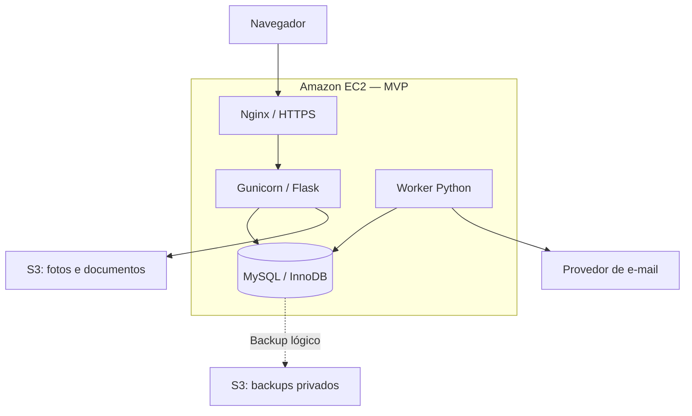

# Design Document — PetGo MVP

## Overview

Fonte normativa: `requirements.md`. Implementar monólito Python/Flask com MySQL transacional, interface Jinja2 e API JSON versionada. A arquitetura prioriza demonstração completa e consistência de pontos, não microserviços.

## Architecture



- EC2 Linux com EBS criptografado; app e MySQL na mesma instância, como solicitado. Dimensionamento inicial proposto: 2 vCPU/4 GiB, sujeito a teste; não é garantia de capacidade nem preço.
- Nginx termina TLS, entrega estáticos e encaminha a socket local Gunicorn. Nunca usar `flask run` como servidor público.
- Flask application factory, Blueprints, SQLAlchemy/PyMySQL, Alembic/Flask-Migrate; validação explícita com Marshmallow; autenticação por sessão usando Flask-Login. Hash via função scrypt do Werkzeug; dependências compatíveis fixadas no lockfile após validação.
- Frontend renderizado por Flask/Jinja2, CSS responsivo e JavaScript progressivo. API `/api/v1` usa a mesma sessão, permissões e proteção CSRF das telas. Sem JWT/refresh token no MVP.
- Worker Python separado, supervisionado por systemd, processa outbox MySQL, reenvios e expiração de vouchers. Redis, Celery e SNS não são dependências do MVP.
- Adaptador de e-mail via SMTP autenticado; SES pode ser usado via SMTP como opção de implantação. Confirmar remetente, permissões e eventuais restrições da conta escolhida antes da demonstração. Ambiente de desenvolvimento usa caixa de testes, sem disparo a destinatários reais.

## Components and Interfaces

| Módulo | Responsabilidade |
|---|---|
| auth / users | Registro, sessão, verificação de e-mail, recuperação e preferências |
| organizations | ONG, membros, validação administrativa e autorização institucional |
| pets | Cadastro, consulta, mídia, custódia e histórico |
| rescues | Assunção exclusiva, comprovação e confirmação |
| adoptions | Pedidos, reserva, entrega e confirmação |
| gamification | Política versionada, carteiras, crédito único e estornos |
| rewards | Parceiros, benefícios, estoque, troca e voucher |
| notifications | Eventos, seleção de destinatários, outbox e adaptador SMTP |
| admin | Verificações, moderação, correções e auditoria |

Fluxo de dependência: Blueprint → schema de validação → serviço → repositório/ORM. Serviços controlam transações; repositórios não fazem commits isolados. Os endpoints não atribuem pontos diretamente.

## Data Models

Todas as tabelas usam chave primária, timestamps UTC, InnoDB, `utf8mb4`, FKs e índices adequados. Valores monetários não existem no saldo: pontos são inteiros. IDs abaixo são BIGINT; tokens públicos/vouchers são aleatórios e não sequenciais.

| Tabela | Campos e restrições principais |
|---|---|
| users | name, email_normalized UNIQUE, password_hash, email_verified_at, city, state, phone opcional, interested_in_adoption, species_preferences JSON, email_opt_in, all_locations, is_active, is_admin |
| auth_tokens | user_id FK, token_hash UNIQUE, purpose, expires_at, used_at; nunca persistir token puro |
| ngos | name, cnpj_normalized UNIQUE, contact_email, city, state, verification_status, verified_by FK, verified_at, rejection_reason |
| ngo_members | ngo_id FK, user_id FK, active, role; UNIQUE(ngo_id,user_id) |
| pets | publisher_user_id FK imutável, responsible_user_id FK NULL, responsible_ngo_id FK NULL, species, size, sex, age_months, help_type, status, description, city, state, private_location, risk_status, risk_details, risk_decided_by FK, risk_decided_at, rescued_at, adopted_at, adopter_user_id FK, deleted_at, version |
| media | pet_id FK ou ngo_id FK, storage_key UNIQUE, content_type, size_bytes, purpose, visibility, uploaded_by FK |
| pet_events | pet_id FK, event_type, actor_user_id FK, acting_ngo_id FK NULL, from_status, to_status, reason, evidence_media_id FK NULL, metadata JSON |
| rescues | pet_id FK, ngo_id FK, executor_user_id FK, status, evidence_media_id FK, confirmed_by FK, confirmed_at |
| adoption_requests | pet_id FK, applicant_user_id FK, status, origin_status, participating_ngo_id FK NULL, reviewed_by FK, delivery_confirmed_at, receipt_confirmed_at, completed_at |
| wallets | user_id FK NULL UNIQUE, ngo_id FK NULL UNIQUE, balance BIGINT DEFAULT 0; exatamente um titular |
| point_awards | pet_id FK, phase (`PUBLICATION`,`OUTCOME`), event_id FK, risk_snapshot, policy_version, status (`WAITING_RISK`,`SETTLED`,`REVERSED`); UNIQUE(pet_id,phase) |
| point_entries | wallet_id FK, award_id FK NULL, redemption_id FK NULL, correction_id FK NULL, amount BIGINT, kind, reason, entry_key UNIQUE; imutável |
| partners | name, status, contact_email, terms |
| partner_members | partner_id FK, user_id FK, active; UNIQUE(partner_id,user_id) |
| rewards | partner_id FK, name, description, cost_points, stock, starts_at, ends_at, voucher_lifetime_days, eligibility, fulfillment_terms, active |
| redemptions | wallet_id FK, reward_id FK, cost_snapshot, terms_snapshot, status, voucher_hash UNIQUE, voucher_ciphertext, expires_at, consumed_at, consumed_by FK |
| outbox_events | event_key UNIQUE, type, payload JSON, status, attempts, next_attempt_at, lease_until |
| email_deliveries | event_id FK, user_id FK, recipient_email_snapshot, template, status, attempts, provider_id, next_attempt_at, lease_until, sanitized_error; UNIQUE(event_id,user_id,template) |
| audit_logs | actor_user_id FK, action, target_type, target_id, reason, correlation_id, sanitized_metadata |
| idempotency_keys | actor_user_id FK, operation, key, request_hash, response_status, response_body, expires_at; UNIQUE(actor_user_id,operation,key) |

Regras de schema e serviço:
- Em `pets`, exatamente um responsável entre pessoa e ONG; publicador pode ser esse responsável inicialmente. Identidades institucionais nunca se autenticam com senha compartilhada.
- Em `wallets`, exatamente um FK de titular não nulo. Em `point_entries`, `amount != 0` e origem compatível com `kind`.
- Índices de busca: pets(status,city,state,species), pets(risk_status,status), email_deliveries(status,next_attempt_at), redemptions(status,expires_at), point_entries(wallet_id,id).
- Unicidade de atendimento ativo: coluna gerada `active_pet_id = CASE WHEN status IN ('ASSUMED','PENDING_CONFIRMATION') THEN pet_id ELSE NULL END`, UNIQUE. MySQL permite múltiplos NULL.
- Pedidos ativos: coluna gerada para pet e solicitante enquanto `SENT`,`UNDER_REVIEW`,`APPROVED`; UNIQUE(par ativo). Reserva única: coluna gerada com pet_id quando `APPROVED` ou `COMPLETED`, UNIQUE.
- Confirmar suporte e semântica das constraints na versão MySQL selecionada; validar migrações no MySQL real. O bloqueio do pet é obrigatório mesmo com constraints.
- Não usar `ON DELETE CASCADE` sobre carteiras, lançamentos e eventos. Desativar/anonimizar entidades preservando a integridade do histórico.
- Campos privados de localização e comprovação não integram DTO público. URL privada é assinada e temporária após autorização.

## State Machines

| Estado atual do pet | Próximo estado | Gatilho autorizado |
|---|---|---|
| NEEDS_RESCUE | IN_RESCUE | ONG aprovada assume |
| IN_RESCUE | NEEDS_RESCUE | ONG cancela antes da conclusão ou admin libera |
| IN_RESCUE | SHELTERED | Resgate comprovado e confirmado |
| SHELTERED | AVAILABLE | Responsável declara aptidão para adoção |
| AVAILABLE | ADOPTION_PENDING | Responsável aprova um pedido |
| NEEDS_RESCUE | ADOPTION_PENDING | Adoção direta aprovada, sem resgate ativo |
| ADOPTION_PENDING | ADOPTED | Entrega e recebimento confirmados |
| ADOPTION_PENDING | Estado de origem | Cancelamento antes da entrega |
| Estados não finais | UNAVAILABLE | Moderação ou impedimento com motivo |
| ADOPTED / UNAVAILABLE | Estado decidido | Correção administrativa excepcional, sem novo bônus automático |

Pedido: `SENT → UNDER_REVIEW → APPROVED → COMPLETED`; é permitido aprovar diretamente de SENT. SENT/UNDER_REVIEW podem ir a REJECTED/CANCELLED; APPROVED pode ir a CANCELLED antes da entrega. Pedido terminal não reabre; nova solicitação exige estado elegível. Atendimento: ASSUMED → PENDING_CONFIRMATION → CONFIRMED, ou CANCELLED antes da confirmação.

Estado do pet, decisão de risco e liquidação de pontos são dimensões distintas. Animal resgatado não fica preso no estado de risco pendente.

## Transaction Algorithms

### Publicar pet

1. Autenticar e autorizar; validar entrada e mídia já enviada para área temporária privada.
2. Iniciar transação e reservar chave de idempotência com hash do pedido.
3. Criar pet, mídia, evento PUBLICATION e point_awards PUBLICATION.
4. Criar carteira se necessário, bloquear carteira e lançar +5 com chave única `award:{id}:wallet:{id}:credit`; atualizar saldo.
5. Criar outbox PET_PUBLISHED e resposta idempotente; commit. Somente então retornar 201.
6. Se houver rollback, não publicar fotos órfãs; rotina remove arquivos temporários sem referência após prazo. MySQL e S3 não são transação distribuída.

### Confirmar resgate / adoção

1. Iniciar transação; reservar idempotência; bloquear pet com `SELECT ... FOR UPDATE`.
2. Validar estado, ator, vínculo, evidência e confirmação independente; bloquear atendimento/pedido afetado.
3. Aplicar evento e transição. Na adoção, confirmar ambas as partes e encerrar pedidos concorrentes.
4. Se já existe point_awards OUTCOME, não criar outro; adoção posterior ao resgate só atualiza o ciclo de vida.
5. Caso contrário criar award OUTCOME com executor/ONG e evidência do evento. Risco pendente: `WAITING_RISK`, sem crédito; risco decidido: liquidar política v1.
6. Bloquear carteiras em ordem crescente de ID; inserir créditos com chaves únicas, atualizar saldos e marcar award SETTLED. Gravar outbox e resposta; commit.
7. Na decisão de risco, bloquear o mesmo pet/award e liquidar WAITING_RISK uma vez. Decisão após SETTLED segue correção administrativa, sem edição retroativa silenciosa.

Política v1: PUBLICATION = publicador +5. OUTCOME normal = publicador +10, ONG elegível +15. OUTCOME risco aprovado = publicador +20, ONG elegível +40. Ausência de ONG = nenhum crédito institucional. O autor e um representante da ONG podem ser a mesma pessoa; carteiras permanecem distintas, mas a comprovação precisa de administrador independente.

### Trocar prêmio

1. Autenticar titular/representante e reservar idempotência; bloquear carteira, depois prêmio, em ordem fixa em todo fluxo.
2. Verificar saldo, suspensão, parceiro ativo, elegibilidade, validade e estoque.
3. Inserir redemption com custo/condições imutáveis e voucher criptograficamente aleatório; persistir hash para busca e cópia cifrada para reapresentação autorizada. Chave de cifra fora do banco e incluída na estratégia segura de recuperação.
4. Debitar pontos, inserir lançamento REWARD_DEBIT, decrementar estoque, criar outbox; commit.
5. Resposta repetida devolve a mesma troca. Chave igual com corpo diferente retorna 409.
6. Uso de voucher bloqueia redemption e exige parceiro correspondente; só ISSUED não expirado vira USED. Cancelamento/expiração usa a mesma ordem de locks, devolve saldo/estoque e grava REFUND com chave única por redemption. Se uso e expiração competirem, apenas a transição válida vence.

### Idempotência e correções

`Idempotency-Key` obrigatório em publicação, assunção, confirmações, troca, uso/cancelamento de voucher e decisões administrativas financeiras. Identidade autenticada e operação compõem o escopo. Chave tem prazo proposto de 7 dias; constraints de domínio permanecem para sempre. Para publicação, após expiração da chave pode haver nova requisição: revisão de duplicidade e estorno impedem uso abusivo, sem prometer deduplicação automática perfeita de animais.

Deadlock transacional pode sofrer repetição limitada pelo servidor; jamais enviar e-mail ou consumir voucher externo antes de commit. Correções administrativas usam `correction_id` único e lançamentos compensatórios; invalidar um pet não apaga automaticamente uma troca já utilizada.

## Notifications and Reliability

- Evento e estado de negócio são gravados juntos no MySQL. Worker seleciona eventos com lease e bloqueio, expande destinatários compatíveis e cria email_deliveries sob constraint única.
- ONG recebe via representantes ativos com preferências institucionais habilitadas; cada usuário recebe no máximo uma cópia por evento/template, mesmo se representar duas ONGs. Endereço de contato institucional não cria assinatura paralela automática.
- Antes de cada envio, revalidar consentimento, conta ativa e e-mail atual. Se e-mail mudou, cancelar entrega antiga e aguardar endereço verificado, sem enviar para endereço anterior.
- Estados: PENDING, PROCESSING, ACCEPTED_BY_PROVIDER, FAILED, CANCELLED. Limite proposto: 5 tentativas com intervalos de 1, 5, 15, 60 e 240 minutos; falha permanente vai direto a FAILED. Lease expirado permite retomada.
- Sem provedor com chave idempotente, timeout após aceite pode gerar e-mail duplicado. A outbox garante persistência e tentativas, não entrega exatamente uma vez. Pontos e estoque continuam protegidos transacionalmente.
- Descadastro assinado de escopo limitado e opção de configuração no perfil. Alertas de novos pets obedecem consentimento; notificações operacionais só para os envolvidos, com política informada.

## API Contract

Base `/api/v1`; JSON snake_case; datas ISO 8601 UTC. Sessão via cookie Secure/HttpOnly/SameSite=Lax; CSRF obrigatório para mutações, inclusive JSON. Web e API compartilham serviços.

| Método e rota | Ator / efeito | Sucesso |
|---|---|---|
| POST /users | Público: criar conta | 201 |
| POST /auth/login; POST /auth/logout | Criar/encerrar sessão | 200 / 204 |
| POST /auth/verify-email; POST /auth/forgot-password; POST /auth/reset-password | Tokens de uso único | 200 / 202 / 200 |
| GET /me; PATCH /me | Titular: perfil/preferências | 200 |
| POST /ngos; GET /ngos; GET /ngos/{id} | Cadastro autenticado / perfil institucional público sanitizado | 201 / 200 |
| POST /admin/ngos/{id}/decision | Admin: aprovar/rejeitar/suspender | 200 |
| POST /pets; GET /pets; GET /pets/{id} | Publicação autenticada; consulta pública sanitizada | 201 / 200 |
| PATCH /pets/{id}; DELETE /pets/{id} | Responsável/admin; edição comum/exclusão lógica | 200 / 204 |
| POST /pets/{id}/availability | Responsável: SHELTERED → AVAILABLE | 200 |
| POST /pets/{id}/risk; POST /admin/pets/{id}/risk-decision | Relato / decisão de risco | 200 |
| POST /pets/{id}/rescues | Representante ONG: assumir | 201 |
| POST /rescues/{id}/submit; POST /rescues/{id}/confirm; POST /rescues/{id}/cancel | Executar fluxo R04 | 200 |
| POST /pets/{id}/adoptions; GET /me/adoptions | Adotante: criar/acompanhar | 201 / 200 |
| GET /pets/{id}/adoptions | Responsável/admin: candidatos autorizados | 200 |
| POST /adoptions/{id}/review; POST /adoptions/{id}/cancel | Decisão ou cancelamento autorizado | 200 |
| POST /adoptions/{id}/delivery; POST /adoptions/{id}/receipt | Confirmações distintas | 200 |
| GET /me/wallet; GET /me/wallet/entries | Titular | 200 |
| GET /ngos/{id}/wallet; GET /ngos/{id}/wallet/entries | Representante ativo/admin | 200 |
| POST /admin/partners; POST /admin/partners/{id}/decision | Admin: cadastro/aprovação | 201 / 200 |
| GET /rewards; POST /partners/{id}/rewards; PATCH /rewards/{id} | Catálogo / parceiro correspondente/admin | 200 / 201 / 200 |
| POST /rewards/{id}/redemptions; GET /me/redemptions | Trocar / consultar; wallet_id autorizado | 201 / 200 |
| GET /ngos/{id}/redemptions | Representante/admin: histórico institucional | 200 |
| POST /vouchers/consume | Parceiro emissor: uso único | 200 |
| POST /admin/redemptions/{id}/cancel; POST /admin/awards/{id}/reverse | Admin: cancelamento / estorno motivado | 200 |
| POST /media | Autenticado: upload validado | 201 |
| GET /health/live; GET /health/ready | Saúde sem informações sensíveis; ready verifica DB | 200 / 503 |

`PATCH /pets/{id}` não aceita status, risco decidido, publicador, pontos, ONG responsável ou adotante. Transições e troca de custódia são exclusivas dos serviços de domínio.

Erros: 400 JSON inválido; 401 sem sessão; 403 permissão/CSRF; 404 inexistente ou recurso privado fora de escopo; 409 conflito de estado, saldo, estoque ou idempotência; 413 arquivo grande; 415 mídia não suportada; 422 campos inválidos; 429 limite; 503 dependência crítica indisponível. Não propagar stack trace.

Formato: `{"error":{"code":"INSUFFICIENT_POINTS","message":"Saldo insuficiente.","fields":{},"request_id":"..."}}`. Listas: `{"items":[],"page":1,"page_size":20,"total":0}`.

Exemplo de criação (após upload da imagem):
```json
{"species":"DOG","description":"Animal próximo à avenida, precisa de resgate.","city":"Ribeirão Preto","state":"SP","latitude":-21.17,"longitude":-47.81,"help_type":"RESCUE","risk_reported":true,"risk_description":"Circulando entre veículos.","media_ids":[123]}
```
O usuário/carteira beneficiária vem da sessão; valores de pontos não vêm do corpo da requisição.

## UI Design

Preservar a direção visual do design original: interface amigável, cores de marca e badges semânticos, cards com fotos, filtros, foco visível e layout responsivo. Tokens visuais originais estão no apêndice `visual-reference.md`; em conflito funcional, prevalecem estes documentos.

Telas mínimas: início com chamadas “Precisa de resgate” e “Quero adotar”; cadastro/login; formulário de pet; detalhe com histórico público e urgência; painel pessoal com pontos e pedidos; painel ONG com atendimentos e carteira institucional; catálogo de benefícios com condições/custo/estoque; histórico de trocas/voucher; painel parceiro para benefícios e uso de voucher; painel admin para validação, risco e fraude.

Distinguir claramente “Resgatar animal” de “Trocar pontos”. Mostrar risco pendente como relato não validado. O CTA de adoção direta deve explicar a necessidade de confirmar entrega. Na carteira, distinguir pontos de cadastro, desfecho aguardando validação e saldo utilizável. Não exibir recompensa pendente como saldo disponível.

## Deployment and Operations

1. Provisionar EC2, IAM role, Security Group, EBS criptografado e buckets S3 privados. A SPEC não executa provisionamento nem autoriza cobrança automaticamente.
2. Liberar 443 público e 80 apenas para redirecionamento/desafio TLS; acesso administrativo por SSM ou SSH limitado ao IP administrativo, nunca universal. MySQL em 127.0.0.1; Gunicorn em socket Unix.
3. Criar usuário de serviço sem root; usuário MySQL exclusivo com privilégio de runtime e credencial separada para migrações.
4. Instalar dependências fixadas, configurar segredos fora do repositório, executar migrações, criar admin por comando operacional e iniciar Nginx/Gunicorn/worker via systemd. Não publicar senha padrão.
5. Validar DNS/TLS, cabeçalhos de proxy confiáveis e cookie Secure; manter debug desligado. Rotacionar logs e monitorar disco, memória, falhas de worker e entregas.
6. Fazer backup lógico consistente diário do MySQL para S3 privado com criptografia, retenção proposta 7 diários + 4 semanais; incluir mídia e chave de cifra em recuperação segura. Testar restore em banco separado. Meta inicial RPO 24h e RTO 4h precisa ser medida, não prometida sem teste.
7. Antes de atualização: backup, migração validada e plano de rollback. Rollback de código não desfaz migração destrutiva; preferir alterações compatíveis.
8. Restrição explícita: instância única é ponto único de falha. Evolução posterior pode separar MySQL em RDS e worker/app em múltiplas instâncias.

Configuração esperada: APP_ENV, SECRET_KEY, DATABASE_URL, PUBLIC_BASE_URL, AWS_REGION, MEDIA_BUCKET, BACKUP_BUCKET, SMTP_HOST, SMTP_PORT, SMTP_USERNAME, SMTP_PASSWORD, EMAIL_FROM, VOUCHER_ENCRYPTION_KEY. `.env.example` contém só placeholders; IAM role elimina necessidade de chave AWS estática.

## Correctness Properties and Testing Strategy

- P1: um cadastro válido gera exatamente +5 para o publicador; rollback não deixa pet/award parcial.
- P2: cada pet liquida apenas um desfecho; resgate → adoção não duplica pontos.
- P3: risco aprovado dá 25 totais ao publicador/40 à ONG; risco normal dá 15/15; adoção direta sem ONG dá 15 ou 25 apenas ao publicador.
- P4: atendimento/adoção e lançamentos correspondentes são atômicos, exceto espera explícita por decisão de risco.
- P5: uma ONG assume por vez; um adotante é aprovado por vez; concorrência retorna conflito sem efeitos parciais.
- P6: troca normal nunca produz saldo ou estoque negativo; estorno administrativo pode gerar dívida auditada.
- P7: um voucher só é utilizado ou reembolsado uma vez, inclusive sob corrida de uso/expiração.
- P8: todo saldo corresponde à soma de lançamentos; reconciliação detecta divergências.
- P9: autorização por recurso impede acesso a carteiras, vouchers, documentos e localização privada de terceiros.
- P10: falha de e-mail não reverte negócio; tarefas sobrevivem ao reinício do worker.

Executar pytest com cliente Flask para serviços/HTTP; testes transacionais e de concorrência em MySQL real isolado, não somente SQLite. SMTP de teste/mock para falhas e reenvios; armazenamento simulado para validação e cleanup. Incluir cenário completo de publicação → resgate de risco → adoção → troca → uso do voucher e variante de adoção direta normal.

## Referências técnicas consultadas

- Flask, produção/WSGI: https://flask.palletsprojects.com/en/stable/deploying/index.html
- AWS, regras de Security Group: https://docs.aws.amazon.com/AWSEC2/latest/UserGuide/security-group-rules-reference.html

As escolhas de produto e pontuação são decisões desta SPEC, não recomendações extraídas dessas fontes.
