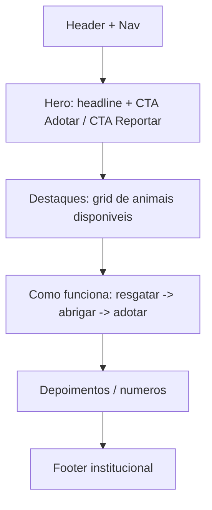
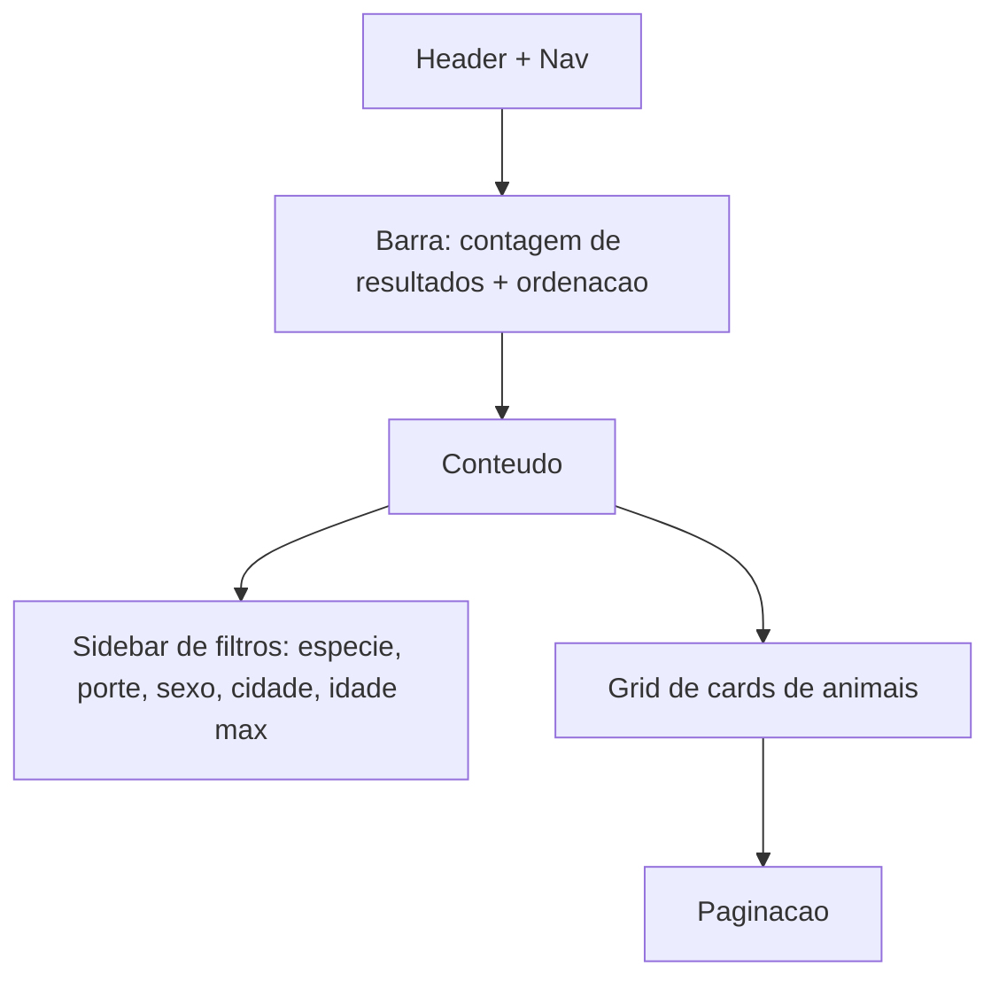
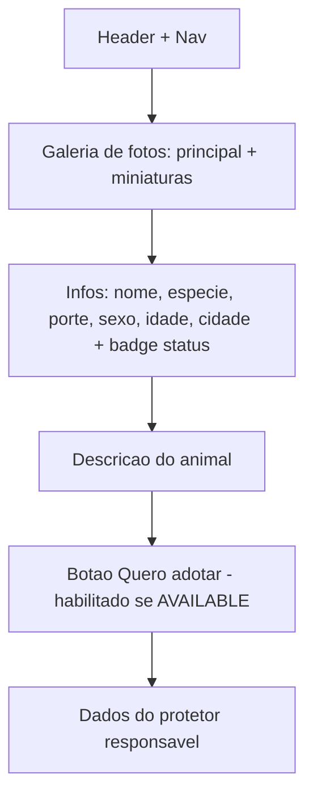
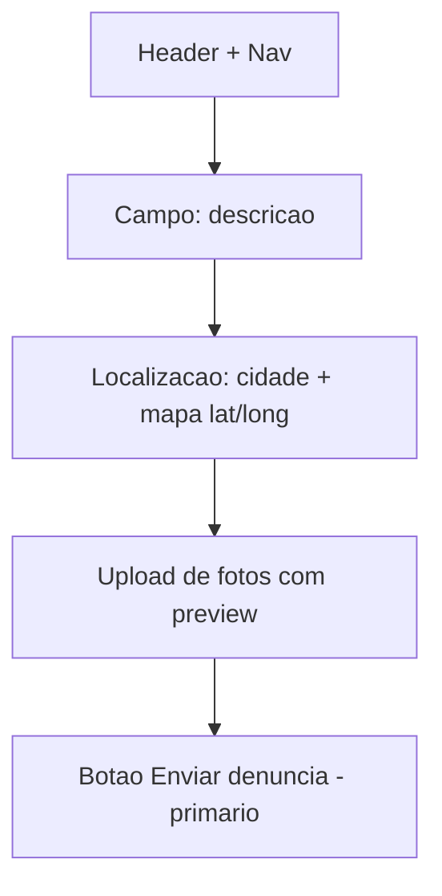
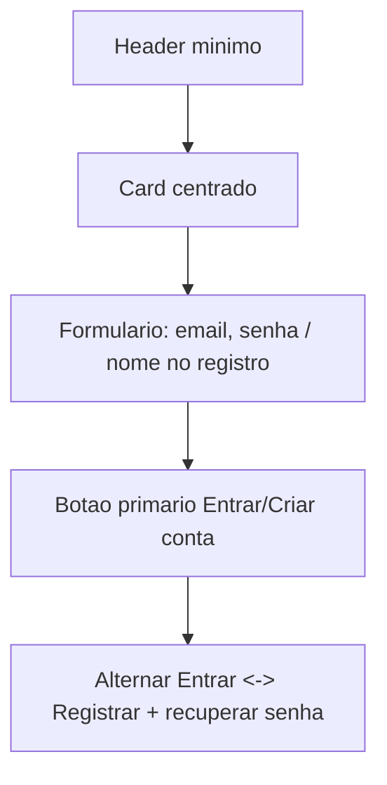
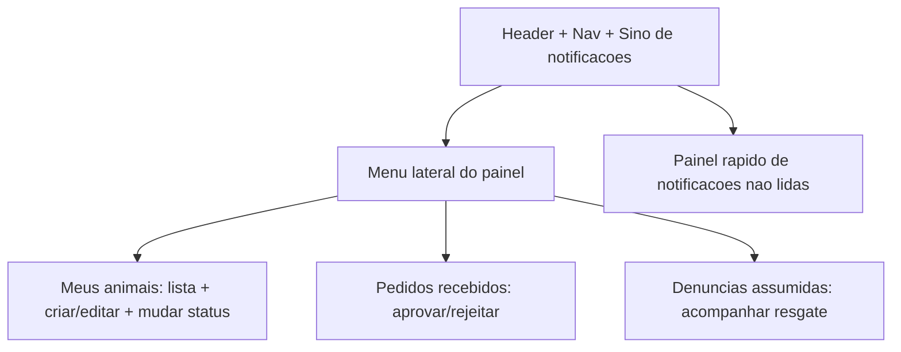

# Referência visual preservada

Trecho do design original, mantido para identidade visual. Papéis, permissões, estados e textos funcionais devem seguir requirements.md e design.md novos.

## Visual Design (UI)

Esta seção documenta a direção visual e o sistema de design da interface **web (Next.js)** do animal-rescue-app. A direção escolhida é **"Confiável e moderno"**: paleta com **azul-petróleo (teal)** como cor primária/institucional e **laranja caloroso** como cor de destaque/ação. O clima é sóbrio, amigável e confiável — adequado a um site de resgate e adoção de animais, onde a confiança do adotante e o destaque às fotos dos animais são essenciais.

> **Observação de escopo:** o design técnico cita web (Next.js) + mobile (React Native). Esta seção foca no **site web**; os tokens de cor, tipografia e espaçamento são agnósticos o suficiente para serem reaproveitados no app mobile com ajustes de densidade.

### 1. Princípios visuais

1. **Acolhedor e confiável** — o teal institucional transmite seriedade e cuidado; o laranja adiciona calor humano sem perder a sobriedade. A interface deve reduzir ansiedade e inspirar segurança em quem adota ou reporta.
2. **A foto do animal é a protagonista** — o layout se apaga para dar espaço às fotos. Cards e páginas de detalhe priorizam imagens grandes e nítidas; cores de UI são suportes, nunca competem com o animal.
3. **Clareza de ações** — toda ação primária (adotar, reportar) usa o laranja de destaque e é inconfundível. Uma cor de ação por vista, hierarquia visual explícita entre primário/secundário/terciário.
4. **Acessibilidade em primeiro lugar** — contraste adequado (alvo WCAG AA), foco visível, área de toque generosa e textos alternativos nas fotos dos animais.
5. **Consistência e economia** — um conjunto pequeno e reutilizável de tokens e componentes; nada de variações ad-hoc de cor ou espaçamento.

### 2. Paleta de cores

A paleta combina o teal institucional (primária) com o laranja de ação (destaque), neutros sóbrios e um conjunto de cores semânticas mapeadas ao ciclo de vida do animal e aos status de adoção.

#### Cores de marca e neutros

| Token | HEX | Uso |
|---|---|---|
| `primary-dark` | `#0F4C5C` | Teal escuro — headers, footer, textos sobre fundo claro que exigem ênfase institucional |
| `primary` (base) | `#15707F` | Teal base — cor institucional principal, links, botão secundário (outline), ícones ativos |
| `primary-light` | `#5FA8B3` | Teal claro — hover de elementos teal, estados ativos suaves |
| `primary-soft` | `#E3F0F2` | Teal suave — fundos de seção/realce, chips neutros, faixas de destaque leve |
| `accent` | `#F08A24` | Laranja de ação — botão primário, CTAs ("Quero adotar", "Reportar"), elementos de ênfase |
| `accent-hover` | `#D9741A` | Laranja hover/pressed do botão primário |
| `accent-soft` | `#FDEBD8` | Laranja suave — realces discretos, badges de atenção leve |
| `bg` | `#F7F9FA` | Fundo da aplicação (cinza-azulado muito claro) |
| `surface` | `#FFFFFF` | Superfície de cards, modais e inputs |
| `border` | `#D9E1E4` | Bordas de cards, inputs e divisores |
| `text-primary` | `#1A2B30` | Texto principal (quase preto com leve matiz teal) |
| `text-secondary` | `#5B6B70` | Texto secundário, legendas, placeholders |

#### Cores semânticas — status do animal (ciclo de vida)

Mapeadas ao enum `AnimalStatus` do design de domínio.

| Status (`AnimalStatus`) | Token | HEX | Significado visual |
|---|---|---|---|
| `NEEDS_RESCUE` | `status-needs-rescue` | `#D7263D` | Vermelho de urgência — precisa de resgate |
| `IN_RESCUE` | `status-in-rescue` | `#E8871E` | Âmbar — resgate em andamento |
| `SHELTERED` | `status-sheltered` | `#7A5CC4` | Roxo — abrigado/lar temporário |
| `AVAILABLE` | `status-available` | `#1E9E6A` | Verde — disponível para adoção |
| `ADOPTED` | `status-adopted` | `#15707F` | Teal (primária) — adotado, desfecho positivo institucional |
| `UNAVAILABLE` | `status-unavailable` | `#8A969B` | Cinza — oculto/indisponível na vitrine |

#### Cores semânticas — status de adoção e feedback

Mapeadas ao enum `AdoptionStatus` e a estados genéricos de feedback.

| Conceito | Token | HEX | Uso |
|---|---|---|---|
| Pedido enviado / em revisão (`SENT`, `UNDER_REVIEW`) | `info` | `#2B7FD4` | Azul informativo — pedido em andamento, avisos neutros |
| Aprovado (`APPROVED`) / sucesso | `success` | `#1E9E6A` | Verde — pedido aprovado, confirmações |
| Rejeitado (`REJECTED`) / erro | `danger` | `#D7263D` | Vermelho — pedido rejeitado, erros de validação |
| Cancelado (`CANCELLED`) / neutro | `neutral` | `#8A969B` | Cinza — pedido cancelado, estados inativos |
| Aviso / atenção | `warning` | `#E8871E` | Âmbar — alertas e pendências |

> **Nota de acessibilidade (contraste):** o alvo é **WCAG AA** (relação de contraste de ~**4.5:1** para texto normal e **3:1** para texto grande/elementos de interface). Cores de fundo claras (`accent`, `accent-soft`, `primary-soft`, `warning`) devem usar **texto escuro** (`text-primary`); cores saturadas escuras (`primary`, `primary-dark`, `danger`, `success`, `info`) comportam **texto branco**. Em badges de status, prefira a cor como **fundo tonalizado + texto na variação escura** ou **cor sólida + texto branco**, nunca cor clara sobre branco puro. **Estes pares de contraste são sugestões e precisam ser verificados** com uma ferramenta de contraste; a conformidade final depende de validação.

#### CSS custom properties

```css
:root {
  /* Marca */
  --color-primary-dark: #0F4C5C;
  --color-primary: #15707F;
  --color-primary-light: #5FA8B3;
  --color-primary-soft: #E3F0F2;

  /* Ação / destaque */
  --color-accent: #F08A24;
  --color-accent-hover: #D9741A;
  --color-accent-soft: #FDEBD8;

  /* Neutros */
  --color-bg: #F7F9FA;
  --color-surface: #FFFFFF;
  --color-border: #D9E1E4;
  --color-text-primary: #1A2B30;
  --color-text-secondary: #5B6B70;

  /* Status do animal (AnimalStatus) */
  --color-status-needs-rescue: #D7263D;
  --color-status-in-rescue: #E8871E;
  --color-status-sheltered: #7A5CC4;
  --color-status-available: #1E9E6A;
  --color-status-adopted: #15707F;
  --color-status-unavailable: #8A969B;

  /* Feedback / status de adoção */
  --color-info: #2B7FD4;     /* SENT / UNDER_REVIEW */
  --color-success: #1E9E6A;  /* APPROVED */
  --color-danger: #D7263D;   /* REJECTED / erro */
  --color-neutral: #8A969B;  /* CANCELLED */
  --color-warning: #E8871E;  /* aviso */
}
```

### 3. Tipografia

**Família sugerida:** **Inter** (via Google Fonts ou `next/font`), por ser neutra, altamente legível em telas e com bom suporte a pesos. Alternativa de fallback do sistema: `system-ui, -apple-system, "Segoe UI", Roboto, sans-serif`.

| Nível | Tamanho / line-height | Peso | Uso |
|---|---|---|---|
| H1 | 36px / 44px | 700 | Título de página / hero |
| H2 | 28px / 36px | 700 | Títulos de seção |
| H3 | 22px / 30px | 600 | Subtítulos, nome do animal no detalhe |
| H4 | 18px / 26px | 600 | Títulos de card, rótulos de grupo |
| Body | 16px / 24px | 400 | Texto corrido padrão |
| Body-strong | 16px / 24px | 600 | Ênfase inline, rótulos |
| Small | 14px / 20px | 400 | Legendas, metadados (cidade, idade) |
| Caption | 12px / 16px | 500 | Badges, notas auxiliares |

Diretrizes: no máximo dois pesos por tela quando possível; comprimento de linha confortável (~60–75 caracteres) em blocos de texto; números e metadados de animais em `Small`/`Caption`.

```css
:root {
  --font-sans: "Inter", system-ui, -apple-system, "Segoe UI", Roboto, sans-serif;
  --fs-h1: 2.25rem;   --lh-h1: 2.75rem;
  --fs-h2: 1.75rem;   --lh-h2: 2.25rem;
  --fs-h3: 1.375rem;  --lh-h3: 1.875rem;
  --fs-h4: 1.125rem;  --lh-h4: 1.625rem;
  --fs-body: 1rem;    --lh-body: 1.5rem;
  --fs-small: 0.875rem; --lh-small: 1.25rem;
  --fs-caption: 0.75rem; --lh-caption: 1rem;
}
```

### 4. Espaçamento e layout

**Escala de espaçamento (base 4px):** `4, 8, 12, 16, 24, 32, 48, 64`. Use múltiplos da escala para margens, paddings e gaps — nunca valores arbitrários.

| Token | Valor |
|---|---|
| `space-1` | 4px |
| `space-2` | 8px |
| `space-3` | 12px |
| `space-4` | 16px |
| `space-6` | 24px |
| `space-8` | 32px |
| `space-12` | 48px |
| `space-16` | 64px |

**Container e grid responsivo:**
- Largura máxima do container de conteúdo: **1200px**, centralizado, com padding lateral de `space-4` (16px) no mobile e `space-6` (24px) no desktop.
- Breakpoints:
  - **Mobile:** `< 640px` — grid de cards com **1 coluna**.
  - **Tablet:** `640px – 1023px` — **2 colunas**.
  - **Desktop:** `≥ 1024px` — **3 a 4 colunas** (3 na listagem com sidebar de filtros; 4 quando filtros ficam no topo).
- Gap padrão do grid de cards: `space-6` (24px).

**Raios de borda e sombras:**

```css
:root {
  --radius-sm: 6px;    /* inputs, chips */
  --radius-md: 12px;   /* cards, botões */
  --radius-lg: 20px;   /* modais, imagens de hero */
  --radius-full: 9999px; /* badges/pills, avatares */

  --shadow-sm: 0 1px 2px rgba(15, 76, 92, 0.06);
  --shadow-md: 0 4px 12px rgba(15, 76, 92, 0.10);
  --shadow-lg: 0 10px 30px rgba(15, 76, 92, 0.14);

  /* Espaçamento (ver tabela acima) */
  --space-1: 4px;  --space-2: 8px;  --space-3: 12px; --space-4: 16px;
  --space-6: 24px; --space-8: 32px; --space-12: 48px; --space-16: 64px;

  --container-max: 1200px;
}
```

### 5. Componentes de UI

#### Botões

- **Primário (laranja):** fundo `accent`, texto branco, `radius-md`; hover `accent-hover`. Usado para a ação principal da tela ("Quero adotar", "Reportar animal", "Enviar"). Apenas um por vista, idealmente.
- **Secundário (teal outline):** fundo transparente, borda e texto `primary`; hover preenche com `primary-soft`. Ações secundárias ("Ver detalhes", "Cancelar filtro").
- **Texto (terciário):** sem borda nem fundo, texto `primary`; hover sublinhado. Ações de baixa ênfase ("Voltar", "Limpar").
- Estados comuns: `hover`, `active/pressed`, `disabled` (opacidade reduzida, sem sombra), `loading` (spinner + rótulo, desabilitado). Altura mínima **44px** para boa área de toque.

```jsx
// Botão primário (ação) e secundário (teal outline) com Tailwind
<button
  className="inline-flex min-h-[44px] items-center justify-center gap-2 rounded-xl
             bg-[var(--color-accent)] px-5 text-white font-semibold
             hover:bg-[var(--color-accent-hover)] disabled:opacity-50
             focus-visible:outline focus-visible:outline-2 focus-visible:outline-offset-2
             focus-visible:outline-[var(--color-accent)]">
  Quero adotar
</button>

<button
  className="inline-flex min-h-[44px] items-center justify-center rounded-xl
             border border-[var(--color-primary)] px-5 font-semibold
             text-[var(--color-primary)] hover:bg-[var(--color-primary-soft)]
             focus-visible:outline focus-visible:outline-2 focus-visible:outline-offset-2
             focus-visible:outline-[var(--color-primary)]">
  Ver detalhes
</button>
```

#### Card de animal

Estrutura: **foto destacada** (proporção ~4:3, ocupa o topo), **badge de status** sobreposto no canto superior, **nome** (H4), **espécie/porte** e **cidade** como metadados (`Small`/`text-secondary`), e uma ação secundária ("Ver detalhes"). O card inteiro é clicável/linkável para a página de detalhe.

```jsx
// Card de animal
<article className="overflow-hidden rounded-xl border border-[var(--color-border)]
                    bg-[var(--color-surface)] shadow-[var(--shadow-sm)]
                    transition hover:shadow-[var(--shadow-md)]">
  <div className="relative aspect-[4/3]">
    
    {/* Badge de status (AVAILABLE) */}
    <span className="absolute left-3 top-3 rounded-full bg-[var(--color-status-available)]
                     px-3 py-1 text-xs font-semibold text-white">
      Disponível
    </span>
  </div>
  <div className="p-4">
    <h4 className="text-lg font-semibold text-[var(--color-text-primary)]">{animal.name}</h4>
    <p className="mt-1 text-sm text-[var(--color-text-secondary)]">
      {animal.species} · {animal.size} · {animal.locationCity}
    </p>
  </div>
</article>
```

#### Badge / chip de status

Pílula (`radius-full`) usando as cores semânticas de status. Para legibilidade, usar **fundo sólido da cor + texto branco** (status escuros/saturados) ou **fundo tonalizado + texto na cor escura** (status claros). Rótulos em `Caption`/`Small`. Exemplos de mapeamento: `NEEDS_RESCUE` → vermelho "Precisa de resgate"; `IN_RESCUE` → âmbar "Em resgate"; `SHELTERED` → roxo "Abrigado"; `AVAILABLE` → verde "Disponível"; `ADOPTED` → teal "Adotado"; `UNAVAILABLE` → cinza "Indisponível".

#### Campos de formulário

Inputs com `surface`, borda `border`, `radius-sm`, padding `space-3`; label acima em `Small`/`Body-strong`; placeholder em `text-secondary`. Foco com anel visível na cor `primary`. Erros usam borda e mensagem em `danger`; ajuda em `text-secondary`. Campos obrigatórios marcados com asterisco e `aria-required`.

#### Barra de navegação / header

Header fixo com fundo `surface` (ou `primary-dark` na versão institucional), logo à esquerda, navegação central (Início, Animais, Reportar), e à direita: ações de autenticação (Entrar/Registrar) ou avatar + **sino de notificações** com contador. CTA "Reportar animal" em destaque (laranja). Em mobile, navegação colapsa em menu hambúrguer.

#### Filtros de busca

Conjunto de controles para `AnimalFilter`: espécie, porte (SMALL/MEDIUM/LARGE), sexo (MALE/FEMALE), cidade e idade máxima (slider/numérico `ageMonthsMax`). No desktop ficam em **sidebar** à esquerda; no mobile, abrem em um **painel/drawer** acionado por botão "Filtrar". Chips mostram filtros ativos com opção de remover; botão "Limpar filtros" (botão texto).

#### Estados vazios e de carregamento

- **Vazio:** ilustração/ícone discreto + texto explicativo + ação (ex.: "Nenhum animal encontrado com esses filtros — limpar filtros"). Tom acolhedor, nunca culpando o usuário.
- **Carregando:** **skeletons** com a forma do card (bloco de imagem + duas linhas de texto) usando `primary-soft`/`border` em animação sutil; evita saltos de layout. Botões em ação assíncrona mostram spinner e ficam desabilitados.

### 6. Layout das telas principais

#### Home / landing

Hero com headline institucional, imagem/collage de animais e **dois CTAs**: "Adotar um animal" (primário, laranja) e "Reportar animal para resgate" (secundário). Abaixo: faixa de destaques de animais `AVAILABLE` (grid de cards), seção "Como funciona" (resgatar → abrigar → adotar) e rodapé.



#### Listagem / busca de animais

Sidebar de filtros (desktop) + grid de cards + paginação. Topo com contagem de resultados e ordenação. No mobile, filtros em drawer.



#### Detalhe do animal

Galeria de fotos (principal + miniaturas), bloco de informações (nome, espécie/raça, porte, sexo, idade, cidade), **badge de status**, descrição, **botão "Quero adotar"** (primário, só habilitado quando `AVAILABLE`) e dados do protetor responsável.



#### Reportar animal para resgate

Formulário com descrição, localização (campo de cidade + **mapa** para marcar latitude/longitude) e **upload de fotos** (múltiplas, com pré-visualização). Validação inline; CTA primário "Enviar denúncia".



#### Login / Registro

Layout centrado, card único com formulário (e-mail, senha; no registro também nome e confirmação). Alternância entre "Entrar" e "Criar conta". Mensagens de erro em `danger`. Link para recuperar senha.



#### Painel do protetor

Área autenticada para o papel `PROTECTOR`: navegação por abas/seções — **Meus animais** (cadastrar/editar, mudar status), **Pedidos recebidos** (aprovar/rejeitar, com auto-rejeição dos demais), **Denúncias assumidas** (acompanhar resgates) — e uma **visão rápida de notificações** (sino com não lidas).



### 7. Acessibilidade e responsividade

- **Contraste:** seguir o alvo **WCAG AA** (~4.5:1 para texto normal, 3:1 para texto grande e elementos de UI). Validar todos os pares cor/fundo com ferramenta de contraste antes de publicar.
- **Área de toque mínima:** alvos interativos de **44×44px** (botões, ícones clicáveis, itens de menu, controles de filtro).
- **Navegação por teclado e foco visível:** toda ação acessível por `Tab`/`Enter`/`Espaço`; anel de foco visível (`outline` na cor `primary`/`accent`); ordem de foco lógica; `Esc` fecha modais e drawers; menus e drawers com `aria-expanded`/`aria-controls`.
- **Textos alternativos:** toda foto de animal recebe `alt` descritivo (ex.: "Foto de Bidu, cão de porte médio"); imagens puramente decorativas usam `alt=""`.
- **Semântica e rótulos:** usar HTML semântico (`header`, `nav`, `main`, `article`), rótulos associados a inputs (`label`/`for`), estados comunicados também por texto/ícone (não só por cor) — especialmente nos badges de status.
- **Responsividade:** o grid de cards adapta colunas por breakpoint (1 / 2 / 3–4); filtros migram de sidebar (desktop) para drawer (mobile); tipografia e espaçamentos fluem na escala definida; imagens com `object-fit: cover` evitam distorção.
- **Movimento:** respeitar `prefers-reduced-motion`, reduzindo animações de skeleton/transição para quem solicita menos movimento.

> **Nota:** estas diretrizes aumentam a acessibilidade, mas **a conformidade WCAG completa exige testes manuais com tecnologias assistivas** (leitores de tela, navegação só por teclado) e revisão por especialista em acessibilidade. Os valores de contraste sugeridos são pontos de partida e devem ser verificados.
